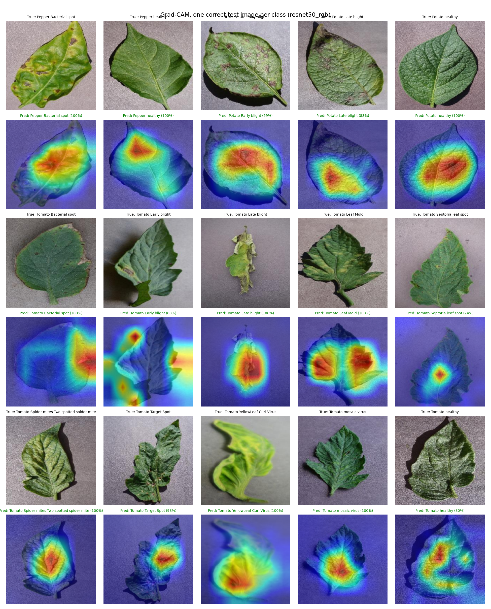
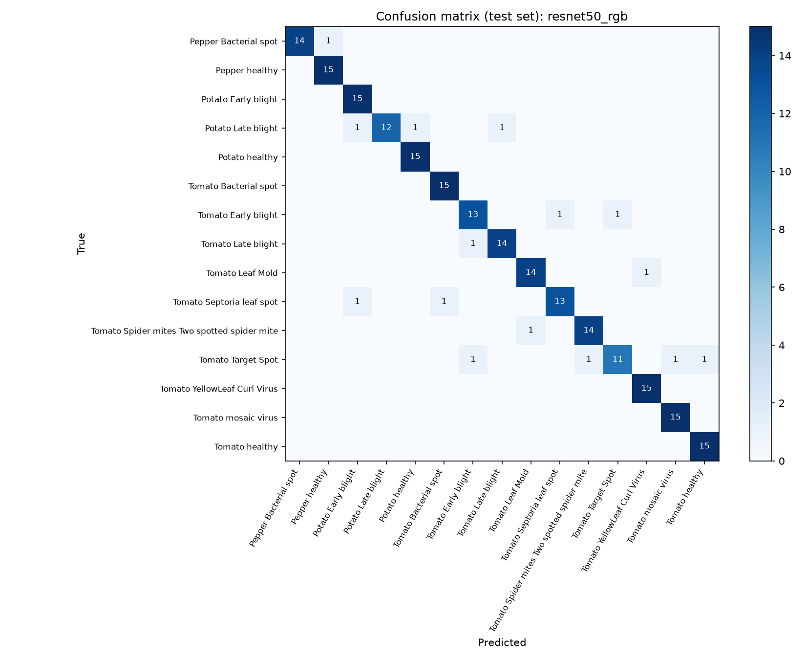
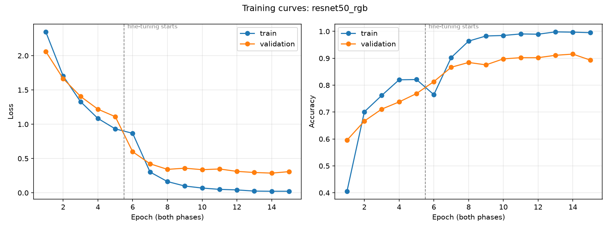

# Plant Leaf Disease Detection with Transfer Learning and Grad-CAM

[](https://github.com/Akkenapallikrishna/plant-disease-detection/actions/workflows/ci.yml)

A PyTorch pipeline that classifies **15 tomato, potato and bell-pepper leaf conditions** from the
PlantVillage dataset, compares two pretrained CNNs and three preprocessing strategies in controlled
experiments, explains predictions with **Grad-CAM**, and serves the final model in a **Streamlit** app.

**Final model (ResNet50, RGB): 93.3% Top-1 · 100% Top-5 · 0.932 macro-F1 · 0.998 ROC-AUC on a held-out test set.**

> Originally a UAB course project (Spring 2026, team of 5). This repository is a rebuilt and
> extended version with a reproducible pipeline, controlled experiments, robustness testing, tests and CI.



---

## Highlights

- **Transfer learning in two phases**: train only a new classification head on frozen ImageNet
  features, then fine-tune the last block with a 10x smaller learning rate. Fine-tuning lifted
  validation accuracy from ~77% to 91.6%.
- **Controlled experiments**: 2 models x 4 preprocessing settings, changing one variable at a time.
- **Robustness test**: every model is also evaluated on test images with camera-like Gaussian noise.
- **Explainability**: Grad-CAM heatmaps for correct and misclassified images.
- **Engineering**: reproducible data split, single shared preprocessing path (no training-serving
  skew), 27 pytest tests and GitHub Actions CI.

## Results

All models: same data split, same seed, same epoch budget (5 head + up to 10 fine-tuning epochs,
early stopping on validation loss). The final model was **selected by validation accuracy before
looking at test results**.

| Model | Colour | Noise aug. | Val acc | Test Top-1 | Test Top-5 | Test macro-F1 | Test ROC-AUC | Noisy-test Top-1 |
|---|---|---|---|---|---|---|---|---|
| **ResNet50** | **RGB** | no | **91.6%** | **93.3%** | **100%** | **0.932** | **0.998** | 88.0% |
| DenseNet121 | RGB | no | 88.4% | 92.4% | 100% | 0.923 | 0.998 | 86.2% |
| ResNet50 | HSV | no | 85.8% | 85.3% | 99.1% | 0.850 | 0.990 | 57.3% |
| DenseNet121 | HSV | no | 85.8% | 88.0% | 99.1% | 0.876 | 0.995 | 36.9% |
| ResNet50 | RGB | yes | 83.6% | 84.9% | 99.1% | 0.842 | 0.994 | **90.2%** |
| DenseNet121 | HSV | yes | 77.3% | 73.8% | 97.3% | 0.705 | 0.986 | 61.8% |
| ResNet50 | HSV | yes | 75.6% | 72.9% | 97.3% | 0.718 | 0.974 | 61.3% |

### Key findings

1. **RGB beat HSV for both architectures** (ResNet50 -5.8 pts, DenseNet121 -2.6 pts on validation).
   ImageNet-pretrained filters were learned on RGB, and hue is a circular value that the network
   sees as two far-apart numbers near 0 and 360 degrees. This contradicts the original project's
   untested assumption that HSV would help.
2. **HSV models are fragile to noise**: DenseNet121-HSV fell from 88.0% to 36.9% on noisy images.
   In dark or low-saturation pixels a small RGB change swings the hue a lot, amplifying camera grain.
3. **Noise augmentation is an accuracy vs robustness trade-off**: it cost 8.4 points on clean test
   images but made ResNet50 the **most robust model on noisy images (90.2%)**, beating the baseline's
   88.0% on the same noisy test set.
4. **Fine-tuning matters**: phase 1 (frozen backbone) plateaued around 77% validation accuracy;
   unfreezing the last block reached 91.6%.

### Per-class performance (final model)

The weakest class is **Tomato Target Spot (73% recall)**: its lesions are tiny specks that nearly
vanish at 224x224. Its 4 errors went to four different classes (healthy, mosaic virus, early blight,
spider mites), suggesting the model simply could not see the lesions.
Late and early blight are also confused with each other (similar brown lesions).



### Grad-CAM insights

- For most correct predictions the heatmap sits on the lesions (bacterial spot, early/late blight).
- **Some predictions use the background or shadows** (e.g. a correct Tomato Early Blight image).
  PlantVillage photos were all taken in lab conditions, so models can learn background shortcuts;
  real-field accuracy would likely be lower.
- Misclassified examples: [`results/gradcam_errors_resnet50_rgb.png`](results/gradcam_errors_resnet50_rgb.png)



## Method

| Step | Details |
|---|---|
| Data | Kaggle PlantVillage (emmarex), 15 classes. Balanced sample of 100 images/class, split 70/15/15 **before** training (seed 42) -> 1,050 / 225 / 225. A duplicate nested folder in the download is skipped to avoid leakage. |
| Preprocessing | Resize 224x224, optional RGB->HSV, ImageNet normalization. Train-only augmentation: flips, +/-20 degree rotation, optional Gaussian noise (std 0.05). |
| Models | ImageNet-pretrained ResNet50 (23.5M params) and DenseNet121 (7.0M) with a new 15-class head. |
| Training | Adam. Phase 1: head only, lr 1e-3, 5 epochs. Phase 2: + last block, lr 1e-4, up to 10 epochs. Early stopping (patience 3) on val loss; best checkpoint kept. Frozen BatchNorm layers stay in eval mode so their running statistics don't drift. |
| Evaluation | Top-1, Top-5, macro-F1, macro one-vs-rest ROC-AUC, confusion matrix, plus the same test set with fixed-seed RGB noise. |
| Explainability | Grad-CAM on ResNet50 `layer4` / DenseNet121 `norm5`. |

Training ran on a laptop CPU (no GPU), about 18-35 minutes per experiment.

## Project structure

```
src/
  prepare_data.py   balanced, reproducible train/val/test split
  dataset.py        transforms (RGB/HSV, augmentation, noise) and DataLoaders
  models.py         model builders, freeze/unfreeze helpers
  train.py          two-phase training with early stopping
  evaluate.py       test metrics, robustness test, plots, summary tables
  gradcam.py        Grad-CAM + shared inference helpers (used by the app)
app/app.py          Streamlit app
tests/              pytest suite (runs on fake images, no downloads)
results/            metrics, confusion matrix, training curves, Grad-CAM figures
```

## Run it yourself

```bash
# 1. Environment (Python 3.11+)
python -m venv venv
venv\Scripts\activate            # macOS/Linux: source venv/bin/activate
pip install torch==2.14.1 torchvision==0.29.1 --index-url https://download.pytorch.org/whl/cpu
pip install -r requirements.txt

# 2. Data: download https://www.kaggle.com/datasets/emmarex/plantdisease and extract it, then
python src/prepare_data.py --source "path/to/PlantVillage"

# 3. Train (or download the trained model, see below)
python src/train.py --model resnet50 --color-mode rgb

# 4. Evaluate and explain
python src/evaluate.py
python src/gradcam.py

# 5. App
streamlit run app/app.py

# Tests
python -m pytest
```

**Pretrained model:** download `resnet50_rgb.pt` from the
[Releases page](https://github.com/Akkenapallikrishna/plant-disease-detection/releases)
and put it in `models/` to run the app without training.

## The app

Upload a leaf photo (or pick a sample) to get the predicted disease, a top-5 chart and a Grad-CAM
heatmap. Predictions below 60% confidence are shown as **uncertain** with a prompt to confirm with
an expert, rather than presented as fact.

## Limitations

- **Lab images only**: plain backgrounds and even lighting. Grad-CAM shows some reliance on
  background, so performance on field photos is expected to be lower.
- **Small sample**: 100 images per class and 15 test images per class, so per-class numbers are
  noisy (one image = 6.7 points of recall).
- **Single seed per experiment**: differences of a few points between runs may partly be chance;
  the RGB > HSV result is supported by holding across both architectures.

## Future work

- Higher input resolution to help small-lesion classes (Target Spot).
- Several seeds per experiment for confidence intervals.
- Train/test on field images (e.g. PlantDoc) to measure the lab-to-field gap.
- Longer DenseNet121 training (it was still improving at the epoch cap).

## Acknowledgements

PlantVillage dataset: Hughes, D. P. & Salathé, M. (2015), *An open access repository of images on
plant health to enable the development of mobile disease diagnostics*. Grad-CAM: Selvaraju et al.
(2017). Grad-CAM implementation: [`pytorch-grad-cam`](https://github.com/jacobgil/pytorch-grad-cam).
